  

 

  

Estudante de Análise e Desenvolvimento de Sistemas na UNIBRA – Centro Universitário Brasileiro, atualmente no 2º período.

Tenho interesse em desenvolvimento de software, computação em nuvem, infraestrutura e segurança da informação. Busco ampliar meus conhecimentos por meio de estudos, cursos e projetos práticos.

Meu foco de desenvolvimento profissional está em Java, Cloud Computing e Cibersegurança.

Formação
Análise e Desenvolvimento de Sistemas
UNIBRA – Centro Universitário Brasileiro
Em andamento – 2º período.

Cloud Computing
Escola da Nuvem
Estudos em AWS, Azure, Linux, redes e infraestrutura em nuvem.

Linguagens e desenvolvimento

  

Ferramentas

  

Cloud e infraestrutura

  

