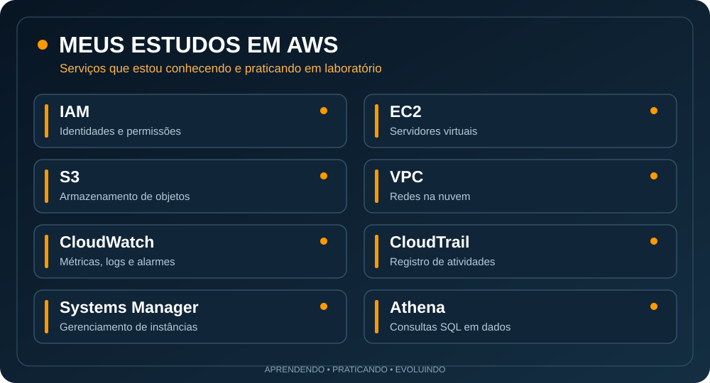
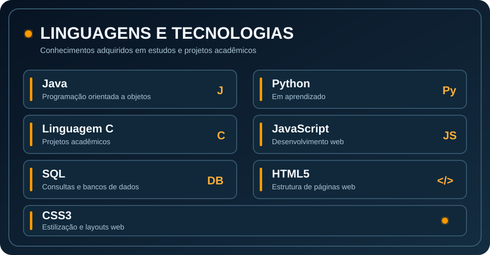
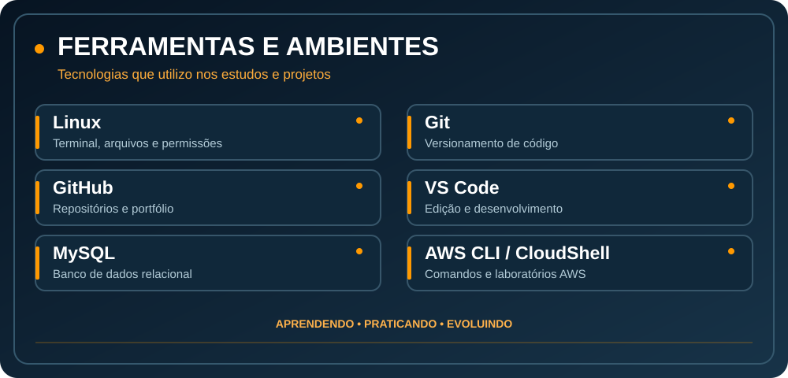
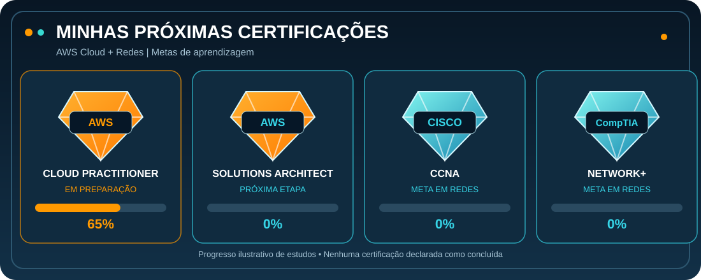

<!-- ====================================== -->
<!-- DIOGENES HENRIQUE | PERFIL GITHUB -->
<!-- ====================================== -->

 

<!-- 2. SERVIÇOS AWS -->

 

<!-- 3. LINGUAGENS DE PROGRAMAÇÃO -->

 

<!-- 4. FERRAMENTAS -->

 

<!-- 5. EVOLUÇÃO NOS ESTUDOS -->

 

<!-- 6. CERTIFICAÇÕES AWS E REDES -->

 

<!-- 7. PROJETOS -->

<a href="https://github.com/Diogeneshenri/projeto-farol-seguranca">Projeto Farol</a> •
<a href="https://github.com/Diogeneshenri/aws-cloud-portfolio">Laboratórios AWS</a>

 

<!-- 8. STATUS DO PORTFÓLIO -->

 

<!-- 9. ESTATÍSTICAS DO GITHUB | AWS | CODE |  -->

<h2>⚡ MINHAS CONTRIBUIÇÕES | AWS | CODE </h2>

<!-- 10. CONTATO -->

